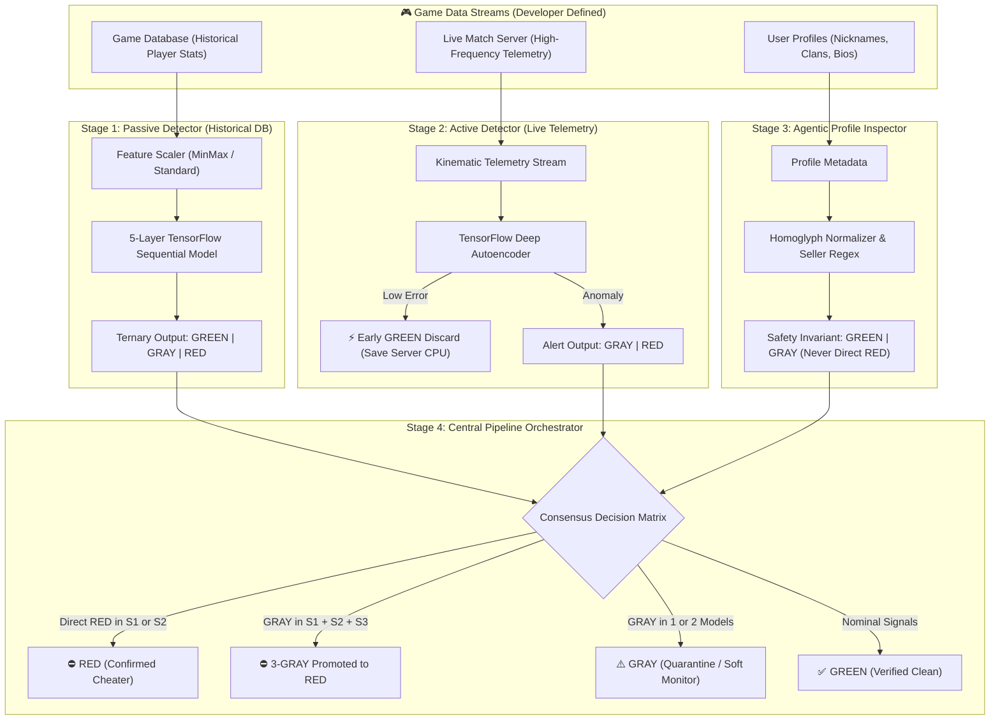

# 🛡️ Cheat Detection System (CDS) — Project Overview

```
+---------------------------------------------------------------------------------------------------+
|                                 CDS: CHEAT DETECTION SYSTEM FRAMEWORK                             |
|                           Next-Generation Behavioral & Multi-Modal AI Engine                      |
+---------------------------------------------------------------------------------------------------+
|  Stage 1 : Passive NLP Detector       | TensorFlow Sequential (5 Layers)  | [GREEN / GRAY / RED]  |
|  Stage 2 : Active Anomaly Detector    | Deep Autoencoder Telemetry Stream | [Early Drop / GRAY / RED]
|  Stage 3 : Agentic Profile Inspector  | Anti-Obfuscation Metadata Audit   | [GREEN / GRAY Only]   |
|  Stage 4 : Pipeline Orchestrator      | Multi-Model Consensus & Balancing | [Studio Handover]     |
+---------------------------------------------------------------------------------------------------+
```

---

## 📌 Executive Summary

The **Cheat Detection System (CDS)** is a modular, high-performance, server-side anti-cheat SDK and framework. It shifts the defensive perimeter away from vulnerable client-side kernel ring-0 drivers to **server-side machine learning, kinematic anomaly detection, and seller network intelligence**.

CDS empowers competitive multiplayer game developers (such as modern Battleground and Battle Royale titles) to detect sophisticated cheats—including **DMA (Direct Memory Access) hardware cards**, **computer vision aimbots**, and **micro-smoothed memory injectors**—without invading player privacy.

---

## ⚡ The Problem: Why Traditional Anti-Cheat Fails

Modern gaming industries face an existential threat from commercial cheat developers who bypass conventional client-side security:

1. **DMA Hardware Cards:** PCIe FPGA cards physically read player coordinates from isolated secondary PCs, leaving zero software trace in the game operating system.
2. **Computer Vision & Hardware HID:** Video capture cards pipe frames into YOLO/TensorRT models that inject aim corrections through physical USB mouse emulators without modifying game memory.
3. **Micro-Smoothed Humanized Aim:** Hacks simulate organic mouse acceleration, non-linear Bezier curves, and variable reaction times to bypass simple statistical thresholds.
4. **Commercial Seller Networks:** Cheaters openly monetize their exploits by putting contact handles (Telegram, Discord, QQ) in usernames and bio profiles.

---

## 💡 The CDS Solution

CDS solves this through a **behavioral, multi-modal, and consensus-driven architecture**:

> **Core Philosophy:**
> No matter what hardware or injection mechanism a cheater uses to evade local detection, **their unfair advantage must ultimately manifest in the game world**—in unnatural statistical win rates, impossible kinematic trajectories, or commercial profile advertising.

---

## 🏗️ The 4 Working Stages of CDS

CDS operates across four synchronized stages that run independently and converge in an automated consensus engine:



### Stage 1: Passive Detector (NLP / Sequential Method)
* **Analyzes:** Historical cumulative player stats extracted from your game database (e.g. Win Rate, K/D, Headshot %, DPM, Account Lifetime).
* **Model:** A **5-Layer TensorFlow Sequential Neural Network** with dynamic input sizing (`input_dim`), ReLU hidden activations, dropout regularization, and Sigmoid binary classification.
* **Cold-Start Training Mode:** When initialized for your game for the first time, you train with an **Answer Key** of known **GREEN** (legitimate, `0`) and **RED** (banned cheaters, `1`). In ground truth, there is no mid-tier `GRAY`.
* **Inference:** Outputs a continuous risk score $[0.0, 1.0]$ partitioned into **GREEN**, **GRAY**, and **RED**.

### Stage 2: Active Detector (Kinematic Anomaly Method)
* **Analyzes:** Real-time in-game match telemetry (movement velocity, vertical height deltas, weapon firing bursts, aim snaps, reaction delays).
* **Model:** A **TensorFlow Sequential Deep Autoencoder** that compresses and reconstructs legitimate gameplay telemetry.
* **Auto-Filtering Optimization:** Clean players have low reconstruction error and are **immediately discarded (dropped)** from memory to preserve server CPU and RAM.
* **Reporting:** High reconstruction errors trigger **GRAY** (moderate anomaly) and **RED** (severe kinematic exploits like speedhacks or flyhacks).

### Stage 3: External Verification (Agentic Profile Method)
* **Analyzes:** User account metadata (nicknames, clan tags, bios, custom status) pulled from the game database.
* **Detection:** Employs Unicode homoglyph normalization (`а` $\rightarrow$ `a`, `0` $\rightarrow$ `o`) and regex word boundaries (`\b`) to uncover commercial cheat brokers (e.g., Discord/Telegram links, DMA shop URLs).
* **Strict Safety Invariant:** A profile alone **CANNOT** definitively brand a player `RED`. Stage 3 outputs **ONLY GREEN and GRAY**.

### Stage 4: Central Pipeline Orchestrator (Multi-Model Consensus)
* **Role:** Balances all three models simultaneously, correlates suspicious indicators, and applies rigorous consensus logic:
  - **Direct RED:** Any direct `RED` from Stage 1 or Stage 2 produces an immediate `RED` verdict.
  - **The 3-GRAY Promotion Rule:** If a player is marked as `GRAY` across **ALL THREE models** (Stage 1 Passive, Stage 2 Active, AND Stage 3 Profile) $\rightarrow$ **Promote to RED**!
  - **The 2-GRAY Retention Rule:** If marked as `GRAY` in only 1 or 2 models $\rightarrow$ **Retain in GRAY** (monitor queue).
  - **Nominal:** Otherwise $\rightarrow$ **GREEN**.

---

## 🗺️ The 2-Stage Studio Deployment Roadmap

Game studios implement CDS in two progressive phases:

```
+---------------------------------------------------------------------------------------+
| PHASE 1: DATABASE INTEGRATION (Currently Ready & Core SDK Analogy)                    |
| - Connect game DB historical stats to Stage 1 Passive NLP Detector.                  |
| - Train cold-start model with historical banned vs clean players.                    |
| - Scan profiles with Stage 3 Agentic Inspector.                                       |
| - Immediately isolate obvious burner accounts, stat anomalies, and sellers.           |
+---------------------------------------------------------------------------------------+
                                           |
                                           v
+---------------------------------------------------------------------------------------+
| PHASE 2: BATTLEGROUND REAL-TIME TELEMETRY (Next-Step In-Game Implementation)           |
| - Hook live match server tick streams to Stage 2 Active Anomaly Autoencoder.         |
| - Drop nominal GREEN frames instantly to maintain low tickrate latency.              |
| - Synchronize live telemetric GRAYs with Stage 1 & Stage 3 using Stage 4.             |
| - Activate studio moderation callbacks (HWID ban, high-tick demo recording).          |
+---------------------------------------------------------------------------------------+
```

---

## 🤝 Developer Handover & Studio Responsibilities

CDS operates on a strict **developer-ownership model**:
1. **Features are decided by YOU:** We provide dynamic models; you choose the database columns and telemetry dimensions that suit your gameplay.
2. **Action Handover:** Once CDS outputs the final classified rosters, your game studio moderates according to your policy:

| Classification | Meaning | Recommended Studio Action |
| :---: | :--- | :--- |
| **`GREEN`** | Clean Player | **Free:** Normal matchmaking and uninterrupted gameplay. |
| **`GRAY`** | Suspicious Player | **Monitor:** Increase server tick sampling (e.g. 128Hz), record match replay demo, or route to soft trust-factor matchmaking. |
| **`RED`** | Confirmed Cheater | **Ban / Quarantine:** Disconnect, account ban, HWID blacklisting, or route to cheater-only shadow lobbies. |

---

## 📂 Quick Links to Implementation & Code

* **Step-by-Step Developer Tutorial:** [`battleground-implementation.md`](battleground-implementation.md)
* **Runnable End-to-End Simulation:** [`examples/quickstart_tutorial.py`](examples/quickstart_tutorial.py)
* **Python SDK Package:**
  - [`cds/scaler.py`](cds/scaler.py) — Dynamic feature normalization (MinMax, Standard, Robust).
  - [`cds/passive_nlp.py`](cds/passive_nlp.py) — 5-Layer TensorFlow Sequential historical DB model.
  - [`cds/active_anomaly.py`](cds/active_anomaly.py) — Deep Autoencoder live telemetry detector.
  - [`cds/agentic_profile.py`](cds/agentic_profile.py) — Anti-obfuscation seller profile inspector.
  - [`cds/orchestrator.py`](cds/orchestrator.py) — Multi-model consensus and callback engine.
* **Automated Test Suite:** [`tests/test_pipeline.py`](tests/test_pipeline.py)
