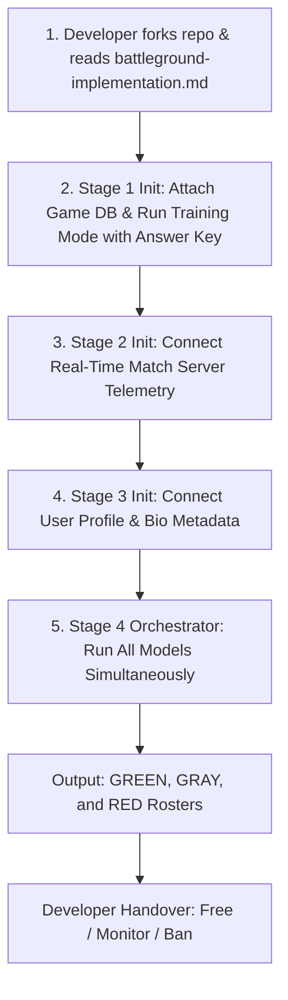

# 🛡️ CDS: Cheat Detection System

<p align="center">
  
  
  
  
</p>

<p align="center">
  <strong>Next-Generation Behavioral & Multi-Modal Anti-Cheat Engine for Competitive Online Games</strong><br>
  <em>Designed for Modern Battleground titles (e.g. PUBG, Warzone, Apex, Free Fire) using Passive NLP, Active Telemetry Anomaly, and Agentic Profile Intelligence.</em>
</p>

---

## 📑 Table of Contents

- [Strategic Product Roadmap](#-strategic-product-roadmap)
- [How CDS Works: The 4 Internal Processing Stages](#-how-cds-works-the-4-internal-processing-stages)
  - [Stage 1: Passive Detector (NLP on Game Database)](#stage-1-passive-detector-nlp-method-on-game-db)
  - [Stage 2: Active Detector (Real-Time In-Game Anomaly)](#stage-2-active-detector-real-time-anomaly)
  - [Stage 3: External Verification (Agentic Profile Inspector)](#stage-3-agentic-profile-inspector-seller-intelligence)
  - [Stage 4: Pipeline Orchestrator & Consensus Engine](#stage-4-central-pipeline-orchestrator--consensus-engine)
- [Developer Onboarding & Workflow](#-developer-onboarding--integration-workflow)
- [End-to-End Architecture Diagram](#-end-to-end-architecture-diagram)
- [The Consensus & Promotion Rules](#-the-consensus--promotion-rules)
- [Developer Responsibility & Enforcement Handover](#-developer-responsibility--enforcement-handover)
- [Repository Structure](#-repository-structure)
- [Running the Simulation](#-running-the-simulation)
- [License & Restrictions](#-license--restrictions)

---

## 🗺️ Strategic Product Roadmap

CDS is developed across two distinct macro stages:
1. **Stage 1 (Core Analogy & Engine — *Current Development*):**  
   The mathematical models, feature scaling pipelines, NLP tokenization engine, and multi-model consensus logic.
2. **Stage 2 (Production Battleground Implementation — *Next Step*):**  
   Targeted integration and deployment reference for **modern online Battleground games** (e.g., 100-player Battle Royale matches with parachuting, terrain elevation, vehicular movement, and long-range ballistic gunplay).

---

## ⚙️ How CDS Works: The 4 Internal Processing Stages

When integrated into a game, CDS runs four coordinated stages:

```
+--------------------------------------------------------------------------------------------------+
|                                    CDS 4-STAGE SYSTEM PIPELINE                                   |
+--------------------------+--------------------------+--------------------------------------------+
| STAGE 1: PASSIVE NLP     | STAGE 2: ACTIVE ANOMALY  | STAGE 3: AGENTIC PROFILE                   |
| (Game DB Historical)     | (Live In-Match Stream)   | (Cheat Seller Intelligence)                |
| • Win rate, K/D ratio    | • Movement speed, Height | • Profile Bio, Nickname, Clan tag          |
| • Headshot %, DPM        | • Live DPM, In-game K/D  | • Detects Telegram / Discord seller links  |
| • Training Mode (Ans Key)| • Micro aim-snap checks  | • Outputs: GREEN / GRAY only               |
| • Outputs: GRN/GRY/RED   | • Outputs: GRAY / RED    |   (Profiles alone cannot be definitely RED)|
+--------------------------+--------------------------+--------------------------------------------+
                                          |
                                          v
+--------------------------------------------------------------------------------------------------+
|                      STAGE 4: CENTRAL PIPELINE ORCHESTRATOR & CONSENSUS ENGINE                   |
| • Runs all 3 models simultaneously and balances compute resources.                               |
| • Collects and cross-routes the GRAY list across models.                                         |
| • 3-GRAY Promotion Rule: Flagged as GRAY in ALL 3 models  ===> Promoted to RED!                  |
| • 2-GRAY Retention Rule: Flagged as GRAY in only 1 or 2   ===> Kept in GRAY for monitoring.      |
+--------------------------------------------------------------------------------------------------+
                                          |
                                          v
                      [ Final GREEN / GRAY / RED Rosters Dispatched to Dev ]
```

### Stage 1: Passive Detector (NLP Method on Game DB)
* **Data Source:** Connects directly to the historical Game Database.
* **Feature Scaling:** Preprocesses and scales historical Battleground metrics: **Win Rate, K/D Ratio, Total Matches/Kills, Headshot Rate, Damage Per Match (DPM), and Account Age**.
* **NLP Representation:** Encodes normalized numerical features into structured semantic tokens, allowing language classification heads to detect unnatural stat combinations.
* **First-Time Cold-Start / Training Mode:**  
  When initializing the repository for the first time, the game developer runs Stage 1 in **Training Mode** providing a ground-truth **Answer Key** containing only **GREEN** (known clean players) and **RED** (confirmed banned cheaters). In ground-truth training, there is no mid-tier GRAY—this teaches the NLP model where legitimate performance ends and hacking begins, allowing it to accurately flag suspicious intermediate **GRAY** players during live inference.
* **Output:** Returns three rosters: `GREEN`, `GRAY`, and `RED`.

### Stage 2: Active Detector (Real-Time Anomaly)
* **Data Source:** Dedicated game server real-time telemetry stream.
* **Metrics:** Live match state:
  * `movement_speed`: Detects speed-hack multipliers.
  * `player_height`: Detects fly-hacks and vertical teleportation.
  * `damage_per_minute (DPM)`: Real-time damage bursts.
  * `active_kd` & `active_headshot_rate`: Unnatural single-match killing sprees.
  * `micro_aim_delta`: Algorithmic snaps and inhuman aim micro-adjustments.
* **Filtering:** Automatically discards clean players (`GREEN`) to conserve CPU tick time, and alerts only on `GRAY` (suspicious) and `RED` (blatant physical impossibilities).
* **Operation:** Runs independently from Stage 1.

### Stage 3: Agentic Profile Inspector (Seller Intelligence)
* **The Insight:** High-tier cheat distributors often use their in-game player ID, nickname, clan tag, and bio status to advertise and sell their cheat scripts, private configs, and software (e.g. `"DM for undetected VIP hack DC: seller#123"`, `"Tele: t.me/ez_win_cheats"`).
* **Mechanism:** Pulls profile data from the database and runs an LLM agentic classifier to detect commercial contact handles and cheat seller language.
* **Safety Boundary:** A player's bio text alone **cannot definitively prove active in-game cheating**. Therefore, Stage 3 outputs **ONLY GREEN or GRAY** (never RED).

### Stage 4: Central Pipeline Orchestrator & Consensus Engine
* Coordinates and balances all models simultaneously.
* Manages data pipelines and aggregates lists.
* Implements the **Cross-Model GRAY Routing**:
  * Puts the GRAY list from one model into the context of the other two models.
  * **The 3-GRAY Promotion Rule:** If a player is flagged as **GRAY across ALL 3 models** (Stage 1, Stage 2, and Stage 3), Stage 4 **promotes them to RED**!
  * **The 2-GRAY Retention Rule:** If a player is flagged as **GRAY in only 1 or 2 models**, they **remain in GRAY** (retained for high-tick monitoring).
  * Direct REDs from Stage 1 or Stage 2 remain **RED**.

---

## 👩‍💻 Developer Onboarding & Integration Workflow

Game developers integrate CDS into their production infrastructure through a simple 5-step process detailed in [**`battleground-implementation.md`**](battleground-implementation.md):



---

## ⚖️ The Consensus & Promotion Rules

| Stage 1 (Passive DB) | Stage 2 (Active Telemetry) | Stage 3 (Profile Bio) | Final Consensus Tier | System Action & Explanation |
| :---: | :---: | :---: | :---: | :--- |
| **RED** | *Any* | *Any* | 🟥 **RED** | **Direct Red Flag:** Flagged by historical DB analysis. |
| *Any* | **RED** | *Any* | 🟥 **RED** | **Direct Red Flag:** Blatant physical speed/aim/height violation in live match. |
| **GRAY** | **GRAY** | **GRAY** | 🟥 **RED** | **3-Gray Promotion:** Suspicious across all 3 independent vectors. Promoted to RED! |
| **GRAY** | **GRAY** | **GREEN** | 🟨 **GRAY** | **2-Gray Retention:** 2 flags present. Retained in high-priority monitor queue. |
| **GRAY** | **GREEN** | **GRAY** | 🟨 **GRAY** | **2-Gray Retention:** Retained in monitor queue. |
| **GREEN** | **GRAY** | **GREEN** | 🟨 **GRAY** | **1-Gray Retention:** Single anomaly spike. Retained in soft-watch list. |
| **GREEN** | **GREEN** | **GREEN** | 🟩 **GREEN** | **Nominal Baseline:** Verified clean player. |

---

## 🛡️ Developer Responsibility & Enforcement Handover

CDS establishes a clear, professional boundary between **threat classification** and **studio policy enforcement**:

```
+------------------------------------+          +------------------------------------+
|             CDS ENGINE             |          |       DEVELOPER GAME BACKEND       |
|                                    |          |                                    |
| [ GREEN ] ---> Verified Clean      |  =====>  | Action: FREE (Normal Matchmaking)  |
| [ GRAY  ] ---> Suspicious / Border |  =====>  | Action: MONITOR (High-Tick Watch)  |
| [ RED   ] ---> Confirmed Cheater   |  =====>  | Action: BAN / SHADOW-LOBBY         |
+------------------------------------+          +------------------------------------+
       ^ Analytical Responsibility                     ^ Enforcement Responsibility
```

* **GREEN List:** The developer frees the player to continue standard matchmaking.
* **GRAY List:** The developer increases telemetry tick sampling (e.g. from 20Hz to 128Hz), saves full demo replays, or routes them to soft trust-factor queues.
* **RED List:** The developer takes disciplinary action (instant match disconnect, HWID/account ban, damage nullification, or silent shadow-banning into cheater-only lobbies).
* **Disclaimer:** CDS holds no liability or responsibility for game studio moderation decisions after delivering the classified rosters.

---

## 📂 Repository Structure

```
CDS/
├── README.md                                  # Designer project overview (You are here)
├── battleground-implementation.md             # Developer integration guide for Battleground games
├── LICENSE                                    # Proprietary View-Only Evaluation License
├── Cheat_Detection_System_Specification.docx  # Full Microsoft Word engineering specification
├── generate_docs.py                          # Docx generation engine
├── src/                                       # Working Python reference implementation
│   ├── __init__.py                            # Package exports
│   ├── stage1_passive_nlp.py                  # Stage 1: DB feature scaling & NLP model
│   ├── stage2_active_anomaly.py               # Stage 2: Real-time telemetry anomaly detector
│   ├── stage3_agentic_profile.py              # Stage 3: Profile & cheat-seller inspector
│   ├── stage4_orchestrator.py                 # Stage 4: Orchestrator & 3-Gray consensus engine
│   └── run_pipeline_example.py                # End-to-end runnable simulation
├── docs/
│   ├── ARCHITECTURE.md                        # Technical subsystem & mathematical formulations
│   └── ANALYSIS_AND_IMPROVEMENTS.md           # Engineering analysis, gaps & recommendations
└── .gitignore                                 # Git ignore configuration
```

---

## 🧪 Running the Simulation

You can execute the complete 4-stage pipeline simulation locally:

```powershell
cd D:\Project\CDS\src
uv run python run_pipeline_example.py
```

This simulates:
1. First-time training mode calibration with ground truth answer key.
2. Ingesting DB stats for Battleground players.
3. Processing real-time speed, height, and aim telemetry.
4. Inspecting profile bios for Discord/Telegram cheat seller patterns.
5. Executing the 3-GRAY to RED promotion rule and producing the final developer dispatch.

---

## 🔒 License & Restrictions

**Copyright (c) 2026 The CDS Project. All rights reserved.**

Distributed under a strict **Proprietary & Confidential Source-Available View-Only License**.  
Viewing and evaluation permitted; copying, forking, redistribution, or unauthorized commercial use strictly prohibited.  
See [`LICENSE`](LICENSE) for full details.
