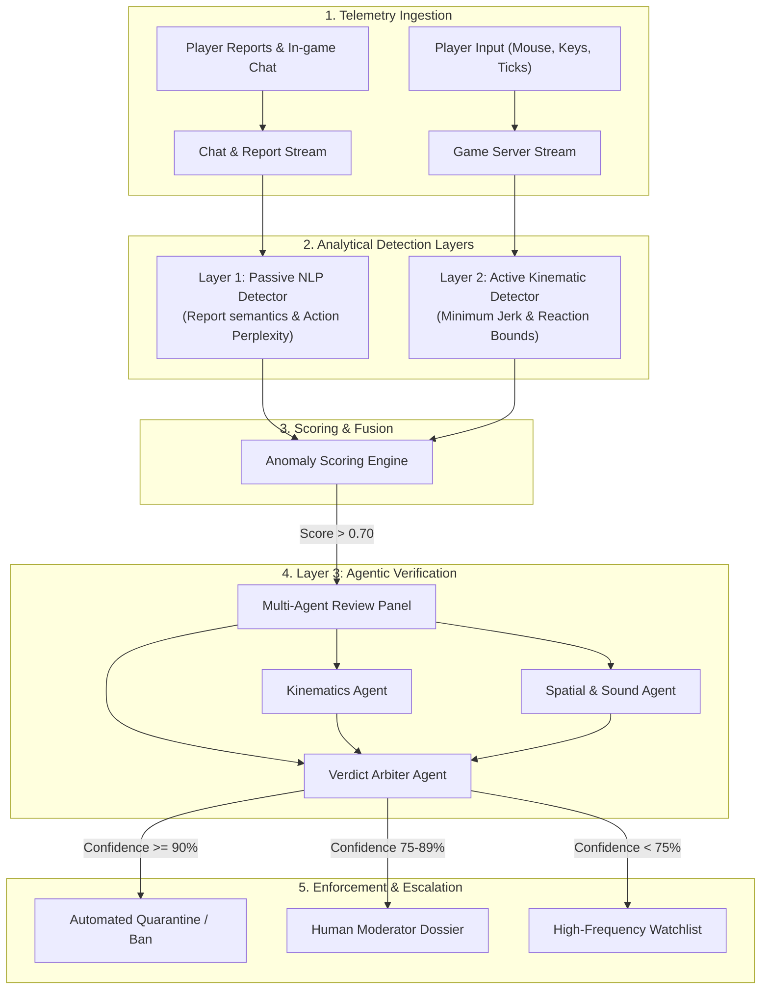

# 🛡️ CDS: Cheat Detection System

<p align="center">
  
  
  
  
</p>

<p align="center">
  <strong>Next-Generation Behavioral & Agentic Anti-Cheat Engine for Competitive Gaming</strong><br>
  <em>Detecting modern DMA hardware cheats, computer vision aimbots, and stealth injections via kinematics, NLP, and multi-agent consensus.</em>
</p>

---

## 📑 Table of Contents

- [The Core Challenge](#-the-core-challenge)
- [System Overview](#-system-overview)
- [The Three-Tier Architecture](#-the-three-tier-architecture)
  - [Layer 1: Passive Detector (NLP Method)](#1-passive-detector-nlp-method)
  - [Layer 2: Active Detector (Kinematic Anomaly Method)](#2-active-detector-kinematic-anomaly-method)
  - [Layer 3: External Verification (Agentic Multi-Perspective Method)](#3-external-verification-agentic-method)
- [End-to-End System Flowchart](#-end-to-end-system-flowchart)
- [Decision & Quarantine Matrix](#-decision--quarantine-matrix)
- [Key Innovations & Critique](#-key-innovations--critique)
- [Project Layout](#-project-layout)
- [Generated Specifications](#-generated-specifications)
- [License & Restrictions](#-license--restrictions)

---

## ⚡ The Core Challenge

Modern cheating has rendered conventional client-side, signature-based anti-cheat systems obsolete:

* **DMA (Direct Memory Access) Hardware Cards:** PCIe-level FPGA cards physically read memory from an isolated second PC, completely evading OS kernel hooks.
* **Computer Vision Aimbots:** Off-box HDMI capture cards process frames using real-time YOLO/TensorRT models and inject hardware-level HID mouse inputs without touching game binaries.
* **Humanized Micro-Smoothing:** Modern hacks emulate organic hand jitter, non-linear Bezier curves, and variable reaction times to fool primitive threshold filters.

> **CDS Core Philosophy:**  
> Rather than fighting an unending battle inside the compromised operating system kernel, **CDS shifts the defensive perimeter to behavioral game analytics, biomechanical telemetry, and multi-agent AI verification.**

---

## 🎯 System Overview

**CDS (Cheat Detection System)** is a server-side and cloud-native anti-cheat engine that inspects player performance, mechanical input kinematics, and reporting linguistics across time:

```
+-------------------------------------------------------------------------------+
|                             CDS MULTI-TIER ENGINE                            |
+------------------------+-----------------------------+------------------------+
|   Layer 1: PASSIVE     |      Layer 2: ACTIVE        |   Layer 3: AGENTIC     |
|   NLP & Behavioral     |     Real-Time Kinematics    |   Multi-Perspective    |
|   • Report linguistics |     • Minimum Jerk checks   |   • Physics sandbox    |
|   • Perplexity models  |     • Reaction time bounds  |   • Occlusion audit    |
|   • Chat intent mining |     • Crosshair correlation |   • Arbiter consensus  |
+------------------------+-----------------------------+------------------------+
```

---

## 🔬 The Three-Tier Architecture

### 1. Passive Detector (NLP Method)
The **Passive Detector** operates asynchronously in the background, analyzing unstructured communication streams and event sequences:
* **Report Credibility Analysis:** Uses fine-tuned NLP transformers to evaluate in-game reports. It separates emotional "salt" reports from forensic observations and weights submissions according to reporter credibility.
* **Chat Intent & Burner Account Detection:** Identifies chat patterns associated with throwaway accounts, admissions ("toggled on"), or advertisements for private injection tools.
* **Game Action Language Modeling:** Treats sequences of game actions as tokens (`AIM_SNAP -> FIRE -> HEADSHOT -> INSTANT_RELOAD`). An autoregressive sequence model calculates sequence perplexity; statistically improbable gameplay rhythms raise passive suspicion flags.

### 2. Active Detector (Kinematic Anomaly Method)
The **Active Detector** monitors real-time player telemetry at game tick rates (64Hz–128Hz), comparing input dynamics against biological human limits:
* **Minimum Jerk Trajectory Validation:** Biological motor control obeys Flash & Hogan’s *Minimum Jerk Principle*. Human flick shots have continuous, bell-shaped acceleration and deceleration curves. Aimbots exhibit discontinuous third-order derivatives ($\frac{d^3\theta}{dt^3}$), unnatural velocity step-functions, or algorithmic dampening.
* **Visual Reaction & Latency Envelopes:** Tracks the millisecond delay between target visibility (clearing occlusion culling) and angular reticle movement. Consistent sub-120ms reaction times across smoke or walls indicate radar or wallhack usage.
* **Crosshair-to-Target Mutual Information:** Quantifies spatial tracking through solid geometry. Even cheaters actively attempting to "act natural" exhibit statistically anomalous crosshair tracking of hidden targets.

### 3. External Verification (Agentic Method)
When Layers 1 or 2 detect elevated anomaly scores, the incident match replay is extracted and handed to an **Autonomous Multi-Agent AI Review Panel**:
* **Kinematics Inspector Agent:** Replays raw input deltas in a virtual physics sandbox to identify synthetic hardware jitter or packet injection flags.
* **Spatial & Sensory Context Agent:** Verifies whether the player had legitimate situational clues (audio footsteps, teammate callouts, radar pings, bullet tracers) that justify suspicious crosshair pre-placement.
* **Arbiter Agent (Consensus Engine):** Synthesizes reports from all agents, calculates a calibrated **Confidence Score (0%–100%)**, compiles an explainable natural-language dossier, and triggers automated enforcement or human moderation escalations.

---

## 🔄 End-to-End System Flowchart



---

## ⚖️ Decision & Quarantine Matrix

| Confidence Tier | Risk Level | Primary Indicators | Automated Action | Escalation Path |
| :--- | :--- | :--- | :--- | :--- |
| **0% – 49%** | Nominal | Normal human variance & natural bell-curve jerk | None | Archived for baseline training |
| **50% – 74%** | Elevated | Occasional sub-120ms reactions or high report volume | Increase server telemetry tickrate to 128Hz | Background watch-list |
| **75% – 89%** | High Anomaly | Repeated angular jerk anomalies & spatial occlusion correlation | Silent shadow-matchmaking (cheater pool) | Dispatched to human review with replay clips |
| **90% – 100%** | Definite Cheat | Discontinuous jerk, sub-80ms reaction, agentic consensus confirmation | Immediate match neutralization & hardware/account ban | Automated audit log with 99.99% certainty proof |

---

## 💡 Key Innovations & Critique

For complete architectural analysis and improvements, see [`docs/ANALYSIS_AND_IMPROVEMENTS.md`](docs/ANALYSIS_AND_IMPROVEMENTS.md). Key enhancements included in this design:

1. **Smurf vs. Cheat Disambiguation:** Differentiates high-skill legitimate players from aimbotters by identifying physiological human imperfections (micro-saccades, overshoots) absent in algorithmic smoothers.
2. **GDPR/CCPA Chat Privacy Shield:** NLP analysis runs on client-side pseudonymized token embeddings to prevent storage of Personally Identifiable Information (PII).
3. **Adversarial Hardening:** Incorporates adversarial training loops simulating synthetic neural aimbots to keep detectors ahead of commercial cheat vendors.
4. **Decoupled Three-Tier Latency Budget:** In-server physics checks (<1ms), streaming anomaly detection (10-50ms), and agentic replay review (asynchronous 5-30s).

---

## 📂 Project Layout

```
CDS/
├── README.md                                  # Designer project overview and documentation
├── LICENSE                                    # Proprietary View-Only Evaluation License
├── PROMPT.md                                 # Original project initiation prompt
├── Cheat Detection System (CDS).md            # Initial conceptual overview
├── Cheat_Detection_System_Specification.docx  # Full Microsoft Word engineering specification
├── generate_docs.py                          # Docx generation engine
├── docs/
│   ├── ARCHITECTURE.md                        # Technical subsystem and algorithmic architecture
│   └── ANALYSIS_AND_IMPROVEMENTS.md           # Engineering analysis, gaps & recommendations
└── .gitignore                                 # Git ignore configuration
```

---

## 📄 Generated Specifications

* 📘 **Word Document Specification:** [`Cheat_Detection_System_Specification.docx`](Cheat_Detection_System_Specification.docx)  
  *Contains the comprehensive 10-section engineering specification, executive summary, mathematical models, data schemas, and phased roadmap.*
* 📑 **Architecture Deep-Dive:** [`docs/ARCHITECTURE.md`](docs/ARCHITECTURE.md)
* 🔍 **Analysis & Recommendations:** [`docs/ANALYSIS_AND_IMPROVEMENTS.md`](docs/ANALYSIS_AND_IMPROVEMENTS.md)

---

## 🔒 License & Restrictions

**Copyright (c) 2026 The CDS Project. All rights reserved.**

This repository is distributed under a strict **Proprietary & Confidential Source-Available View-Only License**.  
* **Permitted:** Reading and viewing for educational, academic, and evaluation purposes.
* **Prohibited:** Forking, copying, cloning for public distribution, modifying, selling, or using this codebase in commercial production without explicit prior written authorization.

See the full terms in the [`LICENSE`](LICENSE) file.
