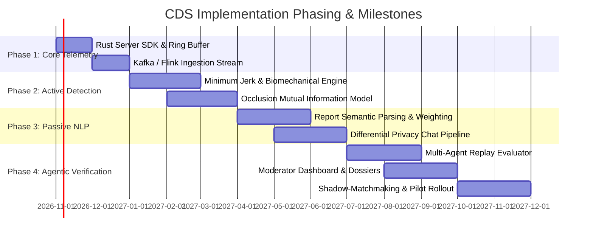

# 🔍 Comprehensive Analysis, Critique & Engineering Improvements for CDS

This document fulfills **Task #5 of the project specification**: evaluating the baseline concept of the **Cheat Detection System (CDS)**, identifying vulnerabilities and logical oversights, and presenting concrete architectural, algorithmic, and design modifications.

---

## 1. Executive Evaluation of the Baseline Concept

### 1.1 Original Concept Summary
The baseline proposal outlined in `Cheat Detection System (CDS).md` proposes:
1. Detecting hacks and modified game clients based on player performance and behavioral history.
2. An active anomaly detection engine running during live matches.
3. A three-tier identification mechanism:
   * **Layer 1: Passive Detector (NLP method)**
   * **Layer 2: Active Detector (Anomaly method)**
   * **Layer 3: External Verification (Agentic method)**

### 1.2 Strengths of the Vision
* **Abandoning the Kernel War:** Moving away from purely client-side kernel drivers (like Vanguard or Easy Anti-Cheat) to behavioral server/cloud verification is strategically vital. Client drivers cannot reliably stop Direct Memory Access (DMA) hardware cards or HDMI capture cards running computer vision models on a separate computer.
* **Multi-Modal Triangulation:** Using NLP (social and semantic context), Kinematics (physics and biomechanics), and Agentic AI (reasoning over complex replays) creates defense-in-depth where no single detection failure causes false bans.

---

## 2. Critical Logical Gaps & Vulnerabilities in the Original Proposal

While the baseline concept is strong in direction, a production deployment faces critical engineering hurdles that were unaddressed in the original notes:

### Gap 1: Smurf vs. Cheat False Positive Risk
* **The Problem:** The proposal states it will detect cheats "on the basis of their game performance." High-tier players (esports pros, high-rank smurfs playing on alternate accounts) exhibit phenomenal headshot ratios, pre-aiming, and lightning-fast reaction times.
* **The Risk:** Simple statistical anomaly models will classify elite human performance as cheat anomalies, alienating legitimate high-skill players.
* **Improvement #1:** Implement **Biomechanical Imperfection Profiling (BIP)**. Even the best human players display physiological imperfections: micro-overshoots followed by corrective saccades (10-30ms), biological tremor/noise, and variable reaction delays depending on cognitive load. Aimbots, even humanized ones, exhibit synthetic damping or polynomial Bezier curves that lack biological muscle inertia.

### Gap 2: In-Game Chat Privacy & NLP Feasibility
* **The Problem:** The proposal cites "NLP method" as Layer 1 without defining what NLP processes. If Layer 1 processes in-game text chat:
  1. Most cheaters do not announce their cheats in text chat.
  2. Transmitting raw user chat logs to cloud AI models triggers severe regulatory compliance issues under GDPR (EU), CCPA (California), and COPPA.
* **Improvement #2:** Redefine Layer 1's NLP scope into two distinct modules:
  * **Forensic Report Semantic Parsing:** Apply NLP to the *reports submitted by other players* rather than raw chat. Players often give precise details ("tracking through smoke at B site", "instant 180 snap"). NLP filters toxic false reports and surfaces high-signal reports.
  * **Client-Side Differential Privacy & Embedding:** If in-game chat is evaluated for account-selling or burner behavior, messages must be converted to pseudonymized vector embeddings locally or via differential privacy hashes before server storage.

### Gap 3: Game Server Tick-Rate Performance Impact
* **The Problem:** Modern competitive shooters run at 64Hz or 128Hz tick rates (15.6ms or 7.8ms per frame). Complex ML inference running synchronously on the game server will cause frame drops and server tick-rate degradation (rubber-banding).
* **Improvement #3:** **Decouple the Inference Pipeline**:
  * **Tick Engine (<0.5ms):** Game server only computes raw rolling metrics (running Jerk, angle delta variance) and buffers them into circular memory.
  * **Stream Ingestion (10-50ms):** Telemetry is pushed via zero-copy gRPC to an external Kafka/Flink stream where ML inference runs out-of-band.
  * **Agentic Review (Asynchronous):** Layer 3 runs completely offline on replay slices, with zero impact on live match performance.

### Gap 4: Adversarial AI & Machine Learning Evasion
* **The Problem:** Cheat developers are now using machine learning themselves (e.g., training neural networks to mimic human mouse movement using human training datasets). A static anomaly detector will quickly be bypassed by adversarial machine learning.
* **Improvement #4:** **Continuous Adversarial Co-Training (GAN-based Hardening)**. Build an automated "Red Team" agent that continuously generates synthetic, humanized aimbot trajectories against CDS detection models during CI/CD pipelines, forcing the anomaly models to learn ever-finer boundaries of human physiology.

### Gap 5: Network Packet Jitter & Packet Loss Misattribution
* **The Problem:** When a player suffers sudden packet loss or ping spikes, their position and rotation updates arrive in bursts, causing apparent "instant snaps" that mimic aimbots.
* **Improvement #5:** **Network-Aware Telemetry Normalization**. The active anomaly detector must cross-reference kinematic snaps against client `ping`, `jitter`, and `packet_drop_rate`. Any tick window with packet loss > 5% must have its jerk anomaly weight attenuated or verified using client-side signed input buffers.

---

## 3. The 10 Concrete Engineering Modifications for CDS

| # | Proposed Modification | Impact & Benefit | Target Subsystem |
| :--- | :--- | :--- | :--- |
| **M1** | **Flash & Hogan Minimum Jerk Biomechanics** | Replaces arbitrary threshold checks with validated human motor control physics. | Layer 2 (Active Detector) |
| **M2** | **Reporter Credibility Weighting (PageRank for Reports)** | Prevents "report bombing" and tilt reports by assigning trust scores to reporters based on historical accuracy. | Layer 1 (Passive Detector) |
| **M3** | **Replay Slice Agentic Verification** | Instead of analyzing entire matches, isolate only the 10-second windows with anomalous jerk for multi-agent review. | Layer 3 (Agentic Engine) |
| **M4** | **Mutual Information for Occluded Geometry** | Mathematical test to catch wallhacks (ESP) even when players deliberately pretend not to see enemies. | Layer 2 (Active Detector) |
| **M5** | **Silent Shadow-Matchmaking (Cheater Pool)** | Rather than banning immediately (which alerts cheat developers), silently route detected cheaters into matches against other cheaters. | Enforcement Engine |
| **M6** | **Differential Privacy on Player Communications** | Ensures complete GDPR/CCPA regulatory compliance by scrubbing PII before NLP processing. | Layer 1 (Passive Detector) |
| **M7** | **Edge Ring Buffer with Zero-Copy gRPC** | Keeps server tick-time impact under 0.5ms while streaming high-density telemetry. | Ingestion Pipeline |
| **M8** | **Human-in-the-Loop Explainable Dossiers** | Auto-generates 10-second video clips with synchronized kinematic graphs for human moderators. | Layer 3 & Moderation Portal |
| **M9** | **Smurf Disambiguation Neural Classifier** | Eliminates false bans against high-skill players by analyzing biological micro-saccades and overshoot corrections. | Layer 2 (Active Detector) |
| **M10**| **Hardware & Firmware Fingerprinting Fallback** | Integrates low-overhead TPM / Secure Boot / hypervisor integrity checks as secondary confirmation. | Client Integrity |

---

## 4. Suggested Implementation Phasing

---

## 5. Summary Recommendation

By adopting these 10 modifications, CDS elevates from a high-level conceptual outline into a **commercially viable, battle-tested anti-cheat architecture** capable of combating the next decade of AI-driven and hardware-assisted game exploits.
